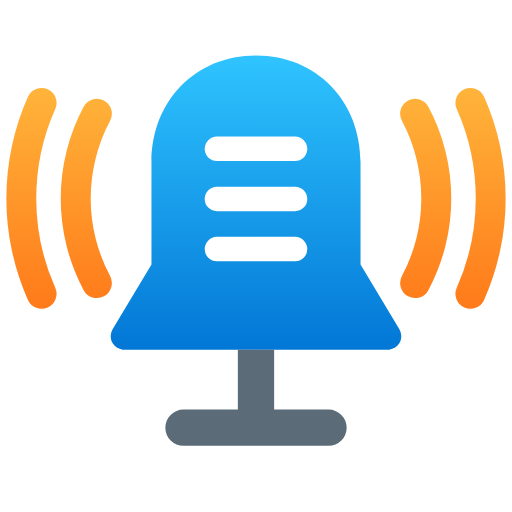

<p align="center">
  
</p>

<h1 align="center">Noticom</h1>

<p align="center"><b>Chimes and a push-to-talk intercom for Home Assistant, using cheap Raspberry Pi speakers around your home.</b></p>

---

## What it does

- 🔔 **Plays sounds when things happen.** Mail arrives, someone rings the
  doorbell, a door opens: pick a sound and pick which rooms hear it.
- 🎙️ **Works as an intercom.** Hold the button on any speaker, talk, let go.
  Your message plays in the other rooms.
- 🖥️ **Everything is managed in Home Assistant.** Upload sounds, choose who
  can talk to whom, and change volume, all from one page.

Each speaker is a small box we call a **node**: a Raspberry Pi with a
microphone board, a little speaker and a button. You can have as many as
you like.

## What you need

- **Home Assistant** (version 2026.3 or newer) with [HACS](https://hacs.xyz)
  installed.
- **One or more nodes.** Each one needs:
  - a Raspberry Pi 3 or newer
  - a ReSpeaker 2-Mic Pi HAT (the Keyestudio version works too)
  - a small speaker plugged into the HAT
  - a push button

Building a node is covered in the
[noticom-node instructions](https://github.com/SubBass100/noticom-node).

## Setup

### 1. Install Noticom in Home Assistant

1. Open **HACS**, click the **⋮** menu (top right) and choose **Custom
   repositories**.
2. Paste `https://github.com/SubBass100/noticom`, choose type
   **Integration**, and click **Add**.
3. Search HACS for **Noticom** and click **Download**.
4. Restart Home Assistant (**Settings → System → ⋮ → Restart**).

A **Noticom** page now appears in the sidebar.

### 2. Set defaults for your speakers (optional)

Open **Noticom → Settings** and choose the starting volume, button
settings and so on. Every node you add from now on starts with these.

### 3. Add your nodes

Set up a node using the
[noticom-node instructions](https://github.com/SubBass100/noticom-node).
Then in Home Assistant:

1. Go to **Settings → Devices & services**. The node shows up under
   **Discovered** within a minute or two.
2. Click **Add**, give it a name (usually the room, like *Kitchen*), and
   click **Submit**.
3. The node beeps. **Press its button within 60 seconds** to confirm.

That's it. The node is connected.

> **Node not showing up?** Click **Add integration**, search for
> **Noticom**, and type in the node's IP address instead.

### 4. Add some sounds

Open **Noticom → Chimes**, drag in a WAV or MP3 file, give it a name like
*mailbox*, and click **Upload**. You can preview it in your browser or play
it on all your nodes to test.

## Playing a sound from an automation

1. In your automation, click **+ Add action**, search for **Noticom**, and
   choose **Play chime**.
2. Pick the **Chime** from the list.
3. Click **+ Choose device** (or area) to pick which nodes play it. **Leave
   it empty to play on every node.**

Here's the same thing in YAML, playing *mailbox* in two rooms:

```yaml
actions:
  - action: noticom.play_chime
    target:
      area_id: [kitchen, office]
    data:
      chime: mailbox
```

To play in rooms like this, assign each node to an area: **Settings →
Devices & services → Noticom**, pick the node, and click the pencil.

**Noticom: Stop** silences nodes right away.

## Using the intercom

1. **Hold** the button on a node.
2. Wait for the short **beep**, then talk (up to 45 seconds).
3. **Let go** to send.

The other nodes play a short chime, then your message. A quick tap does
nothing, so a bumped button won't send anything. A low tone means the
message couldn't be sent, usually because the node is offline.

In **Noticom → Intercom** you can:

- choose the chime that plays before messages
- choose **who each node can talk to**: all nodes, or only some
- **listen to recent messages** and see which rooms heard them

Automations can react to messages too. Every message fires a
`noticom_message` event:

```yaml
triggers:
  - trigger: event
    event_type: noticom_message
    event_data:
      sender: Garage
actions:
  - action: light.turn_on
    target:
      entity_id: light.kitchen
```

## Settings for each node

Each node appears as a device in Home Assistant with:

| Setting | What it does |
|---|---|
| **Connected** | Shows if the node is online |
| **Volume** | Speaker volume |
| **Mic gain** / **Mic boost** | How sensitive the microphone is. Turn these down if messages sound distorted |
| **Push to talk** | Turn the intercom button on or off |

The **button wiring** (which pin, and normally open or normally closed) is
under the node's **Configure** button.

## Removing or resetting a node

- **Delete it in Home Assistant**, and the node resets itself, ready to be
  added again.
- **Or reset it from the button:** press it **5 times quickly**. The node
  asks you to **hold the button for 5 seconds** to confirm. If you let go
  early or don't press, nothing happens.

## Troubleshooting

| Problem | What to try |
|---|---|
| Node doesn't appear under Discovered | Use **Add integration → Noticom** and type its IP address |
| "Couldn't reach the node" when adding | Update the node (re-run its install line). As a quick workaround, run `ping -c 3 <Home Assistant IP>` on the Pi and try again. If you reflashed the Pi, ignore old Noticom cards and add it by IP |
| No sound from a node | Check its **Volume**, and that the speaker is plugged into the HAT's speaker port |
| Messages are too quiet or too loud | Adjust that node's **Mic gain** and **Mic boost** |
| Something else | Check **Settings → System → Logs** and search for `noticom` |

## For developers

- How it all works (protocol, security, audio): [docs/DESIGN.md](docs/DESIGN.md)
- Run the tests:
  ```sh
  pip install -r requirements_test.txt
  pip install -e ../noticom-node   # optional: also runs the end-to-end tests
  python -m pytest
  ```

## License

[Apache-2.0](LICENSE)
